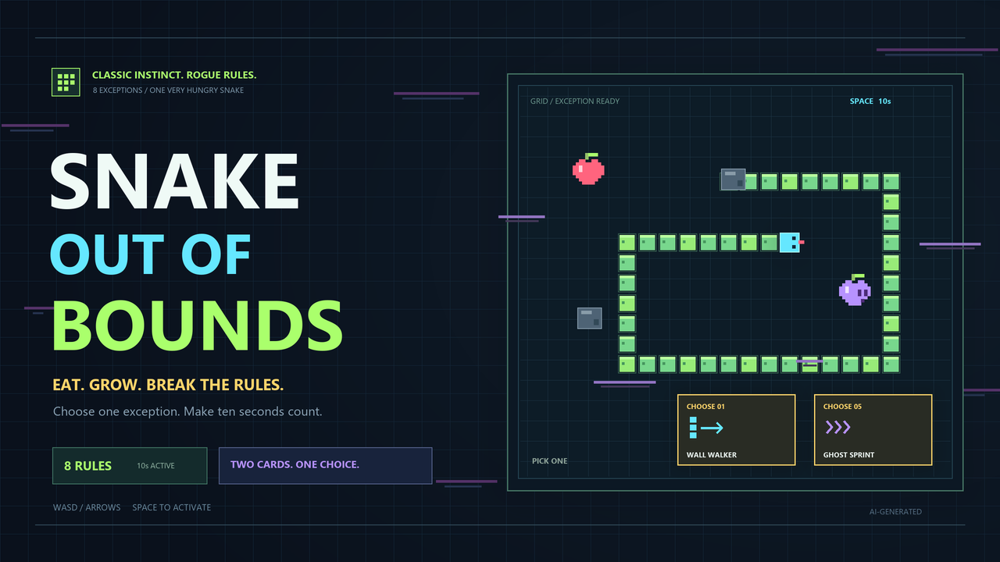

# Snake Out of Bounds

**Snake Out of Bounds** is an endless arcade Snake game built around temporary rule mutations. Eat apples, grow longer, and choose between two rule cards that can turn familiar dangers into short-lived advantages.

Instead of progressing through levels, every run takes place on one continuous board. The goal is to survive, experiment with rule combinations, and earn the highest score possible.

## Bend the Rules

The game includes eight temporary rule overrides:

- **Wall Walker** — wrap through the board edges.
- **Cut the Tail** — survive a body collision by cutting away part of the snake.
- **Antidote** — turn poison into safe, valuable food.
- **Tail Burner** — consume tail segments to generate boost energy.
- **Ghost Sprint** — move at high speed and break through rocks.
- **Value Flip** — reverse which objects are valuable.
- **Food Hunt** — make apples move toward the snake.
- **Center Stage** — keep the snake centered while the world moves around it.

Only one override can be active at a time, so choosing when to use a rule is as important as choosing the rule itself.

## Controls

| Input | Action |
| --- | --- |
| WASD / Arrow keys | Turn |
| Space | Activate the selected rule |
| 1 / 2 | Choose a rule card |
| Shift | Boost using stored energy |
| Esc / P | Pause |
| R | Restart |
| L | Switch English / Chinese |
| M | Toggle sound |

## Play

For the browser version, keep `SnakeOutOfBounds.html` and `game-background.png` in the same folder, then open the HTML file in a modern desktop browser.

Windows players can run `SnakeOutOfBounds-Windows.exe`. The Windows build requires the standard .NET Framework 4.x system component.

## Project Files

- `SnakeOutOfBounds.html` — browser build.
- `game-background.png` — browser gameplay background.
- `SnakeOutOfBounds-Windows.exe` — Windows build.
- `rogue-snake/` — editable browser source, media, release copy, credits, and validation notes.
